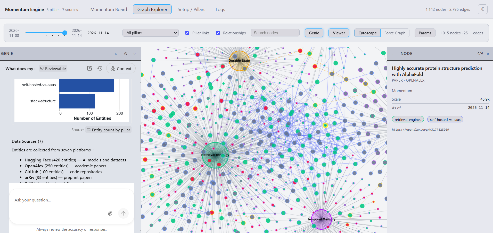
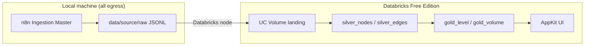

<p align="center">
  
</p>

<h1 align="center">Momentum Engine</h1>

<p align="center">
  <em>Which technology contests are actually accelerating — and which are hype.</em>
</p>

<p align="center">
  Runs the whole ingestion-to-graph pipeline on Databricks Free Edition — zero-cost data collection, a lakehouse of evidence, and a UI that reads it.
</p>

---

## The problem

Technology coverage is dominated by opinion. A paper gets popular, a demo goes viral, a vendor posts a benchmark — and everyone declares a winner. Six months later half of it was noise.

The thing you actually want to know is **directional**: is this area gaining or stalling? And crucially — *is the evidence consistent across independent signals, or is only one kind of signal moving?*

A pillar where papers are rising but production installs are flat is **hype**.
A pillar where trademarks are being filed but nothing else moves is **a bet you can't see yet**.
A pillar where research, code, packages, citations **and** money are all rising is **a real wave**.

Momentum Engine collects all five kinds of evidence on a schedule and keeps them in one graph, so the answer is a query rather than a vibe.

---

## The five pillars

Each pillar is a **contest** — two ways of doing the same job, tracked to see which gains ground.

| Pillar | The contest | Why it matters |
|---|---|---|
| **Self-hosted AI vs SaaS AI** | Run the orchestration yourself, or rent it | Whether AI tooling gets owned by the user or rented per seat |
| **Temporal Memory & Context** | Remembering what changed, or just recalling text | The difference between a chatbot and an assistant that knows you |
| **Retrieval Strategy** | Joins · hops · keywords · vectors · column scans | Five ways to find the right data, competing for the same job |
| **Where Durable State Lives** | Local disk · object store · managed cloud | Where the bytes physically sit, and what that costs |
| **Open Format vs Integrated Platform** | Assemble from open parts, or buy one vendor's box | Who ends up owning the data stack |

> **Caveat on pillar 1.** The self-hosted side is directly measurable (npm and PyPI installs). The SaaS side is not — most SaaS vendors publish no usage numbers. SAAS is shown as a flat baseline with that limitation visible in the UI rather than hidden.

---

## Why it's interesting

**The timeline is real.** The seven sources are ordered by how early they move:

```
arXiv  →  GitHub  →  Hugging Face  →  PyPI / npm  →  OpenAlex  →  USPTO
hours     weeks       weeks–months    months        months–1yr   1–3 yrs
```

Research appears first. Code follows. Models get packaged. Production installs climb. Academia ratifies. **Then money arrives** as trademarks.

Reading that sequence left to right tells you where in its lifecycle a technology sits — not just whether it's big.

**The graph tells you something no single source can.** Nodes are papers, models, repos, packages and trademarks. Edges are citations, dependencies, repo→package links, and trademark→company. Path tracing goes:

```
trademark → company → package → repo → paper
```

That's the paper-to-revenue story, end to end.

**It runs for free.** Databricks Free Edition, n8n on a laptop, public APIs with no paid tiers. The only constraint that shaped the architecture — no outbound network from Free Edition — is why ingestion lives outside the lakehouse.

---

## Architecture



| Stage | What it holds |
|---|---|
| **Bronze** | Raw JSONL in a Unity Catalog Volume — immutable archive |
| **Silver** | Typed, deduped nodes and edges. One row per `(node_id, pillar, observed_at)` |
| **Gold** | `gold_level` (how big) and `gold_volume` (how many) — long format, never summed across units |

All stages are **full rebuilds**. Re-running is always correct and never depends on prior state.

---

## Install

**Prerequisites:** Node 18+, Python 3.10+, Databricks CLI, an n8n instance.

```bash
git clone https://github.com/AxiomLC/databricks-app.git
cd databricks-app

# UI dependencies
cd ui && npm install && cd ..

# Databricks auth
databricks auth login --host https://dbc-0a49a6d2-f0ff.cloud.databricks.com

# config
cp .env.example .env    # fill in workspace, warehouse, token
```

The CLI is what `scripts/export_ui_data.py` shells out to for a token — it is not optional.

---

## Setup

**1. Import the workflow.** n8n → Workflows → Import from File → [`n8n/ingestion-master.json`](n8n/ingestion-master.json). Re-attach three credentials:

| Node(s) | Credential type |
|---|---|
| `USPTO TMs`, `USPTO File List`, `Download TDXF File` | `httpHeaderAuth` (header `X-API-Key`) |
| `Slack · Approve Upload` | `slackApi` |
| `Databricks`, `Databricks1` | `databricksApi` |

**2. Rewrite paths.** `Extract USPTO Gems`, `Write Pillars` and every `Write *JSONL` node carry absolute Windows paths from the original machine. Also needs `scripts/uspto_extract.py` and `pillars.json` on disk.

**3. Build the tables.** Run the notebooks in order:

```
silver_nodes → gold_momentum → silver_edges
```

**4. Point the UI at data.**

```bash
python scripts/export_ui_data.py
```

---

## Operation

### Starting

```bash
./start.bat              # Windows, double-click or run
# or
powershell -File start.ps1 -RefreshSnapshot
```

It checks node/python/CLI, Databricks auth, warehouse reachability and a live query, then starts the UI. Logs to `logs/`.

### Daily cycle

```
05:00  Cron · Daily 05:00      arXiv, HF, GitHub, PyPI, npm, USPTO
Mon 09:00  OpenAlex WEEKLY     OpenAlex only
```

Then, after a run:

```bash
python scripts/export_ui_data.py    # refresh the UI snapshot
```

### When a leg fails

`Gate` holds `ALLOW_PARTIAL = false` — one failing leg blocks the whole batch. `Route` sends it to **Slack** with two buttons:

- **Approve Upload** → the healthy legs upload; the failed one is dropped
- **Cancel Execution** → the run ends, nothing is written

Either way, nothing silently half-lands.

### Editing keywords

`Pillar Keywords` is the single source of truth. It emits 5 items; every leg reads from it. Change it there and everything follows. It also writes `pillars.json` at runtime — that file is an output, never edit it.

---

## Repository layout

| Path | |
|---|---|
| [`n8n/`](n8n/) | Workflow export + canvas reference |
| [`notebooks/`](notebooks/) | Silver and Gold processing |
| [`ui/`](ui/) | React + Cytoscape frontend |
| [`schemas/`](schemas/) | Canonical DDL |
| [`scripts/`](scripts/) | `export_ui_data.py`, `uspto_extract.py`, `egress_check.py` |

---

## Documentation

| Doc | For |
|---|---|
| [`humanREADME.md`](humanREADME.md) | Plain-language walkthrough, no coding assumed |
| [`techREADME.md`](techREADME.md) | Contracts, schemas, commands, debugging |
| [`HANDOVER.md`](HANDOVER.md) | Current state and what's next |

---

## Status

Pipeline verified end to end; UI renders real warehouse data. Pending work — UI polish, graph search, MCP testing, Cypher queries — is tracked in [`HANDOVER.md`](HANDOVER.md).

Not affiliated with Databricks. Built on Free Edition to prove the lakehouse pattern works without a budget.
