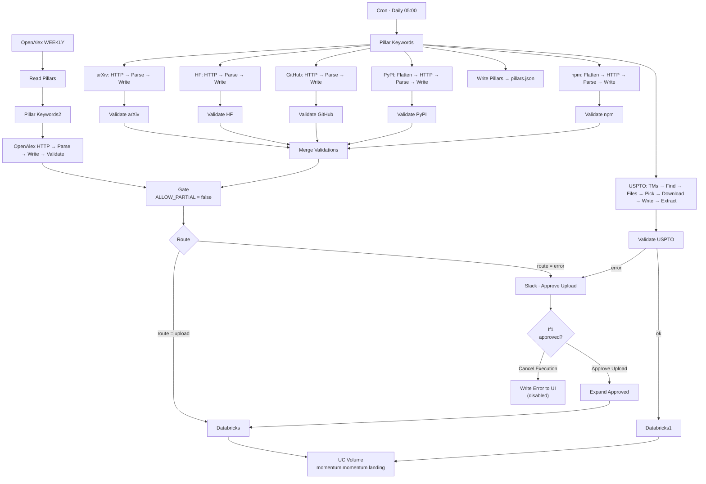

# n8n ingestion

The n8n workflow that fetches public APIs **outside** Databricks and writes
date-partitioned JSONL to a local staging dir (`data/<source>/raw/`), which is then
pushed to the Unity Catalog Volume.

Snapshot in this folder: [`ingestion-master.json`](./ingestion-master.json) — a
Canvas export. The canvas is the source of truth; this file is a reference copy.

## Live canvas

There is **one** workflow, not one per source:

| | |
|---|---|
| Name | `databricks: Ingestion Master (All Legs)` |
| ID | `GQs6702n6vwYjKVa` |
| Nodes | 33 (incl. 4 sticky notes) |
| Connections | 48 |
| Status | active |
| `versionCounter` | 470 at last export |

The original per-source workflows were deleted. Everything lives on this canvas.

## Shape



Reading it as three lanes:

1. **The five scored legs** — arXiv, HF, GitHub, PyPI, npm. All end at
   `Merge Validations`, which feeds `Gate`. These are the only legs that vote on
   whether the run is clean.
2. **USPTO** — a separate lane that ends at `Validate USPTO` and goes straight to
   its own `Databricks1` node. It never touches `Merge Validations` or `Gate`, and
   it has its own `Slack · Approve Upload` branch. Deliberate: it is an unscored
   discovery feed, so a USPTO failure must never block the scored legs.
3. **The exit** — `Route` sends clean batches to `Databricks` and blocked ones to
   Slack for human approval. Approve rebuilds the healthy legs from Gate's
   `manifest` and uploads; Cancel goes to `Write Error to UI` (currently disabled)
   and nothing is written.

`OpenAlex` is wired straight into `Gate`, bypassing `Merge Validations`, because
`Merge` (append mode) waits for every input and would hang on a weekly-only
trigger. Gate still judges it by the same `ok` test as everything else.

> **Why two Databricks nodes.** `Databricks1` exists purely for layout — it saves a
> long wire dragging back across the canvas from `Validate USPTO`. Both nodes write
> to the same `momentum.momentum.landing` volume with identical parameters.

### Node count by role

| Role | Nodes |
|---|---|
| Triggers | `Cron · Daily 05:00`, `OpenAlex WEEKLY`, `TEMP CRON`, `Webhook · temp-debug`, `Test` (manual) |
| Fetch | `arXiv HTTP`, `HF HTTP`, `GitHub HTTP`, `PyPI HTTP`, `npm HTTP`, `OpenAlex HTTP`, `USPTO TMs`, `USPTO File List`, `Download TDXF File` |
| Parse | `Parse arXiv`, `Parse HF Models`, `Parse GitHub Repos`, `Parse PyPI Stats`, `Parse npm Stats`, `Parse OpenAlex`, `Find Latest TDXF`, `Pick Latest File` |
| Write | `Write arXiv JSONL`, `Write HF JSONL`, `Write GitHub JSONL`, `Write PyPI JSONL`, `Write npm JSONL`, `Write OpenAlex JSONL`, `Write TDXF`, `Write Pillars` |
| Validate | `Validate arXiv`, `Validate HF`, `Validate GitHub`, `Validate PyPI`, `Validate npm`, `Validate OpenAlex`, `Validate USPTO` |
| Extract | `Extract USPTO Gems` (Execute Command → `scripts/uspto_extract.py`) |
| Gate / route | `Merge Validations`, `Gate`, `Route`, `Slack · Approve Upload`, `If1`, `Expand Approved`, `Write Error to UI` (disabled) |
| Sink | `Databricks`, `Databricks1` — same volume, `Databricks1` is for layout only |
| Config | `Pillar Keywords`, `Flatten PyPI Packages`, `Flatten npm Packages`, `Read Pillars`, `Pillar Keywords2` |
| Test-only | `Test` (manual trigger), `Test Error Payload` (Code) — remove when the error path is signed off |
| Notes | 4 sticky notes: `READ ME · How this works`, `Sticky Note` (test), `Sticky Note1` (USPTO), `Sticky Note2` (daily legs) |

## Pillar Keywords — the only thing you edit

`Pillar Keywords` is a Code node emitting 5 items. Every leg reads from it.

```js
const PILLARS = [
  { pillar: 'self-hosted-vs-saas', keyword: 'self-hosted AI', hf: 'gguf',      pypi: [...], npm: [...] },
  { pillar: 'temporal-memory',     keyword: 'agent memory',  hf: 'memory',    pypi: [...], npm: [...] },
  { pillar: 'retrieval-engines',   keyword: 'approximate nearest neighbor', hf: 'graph', pypi: [...], npm: [...] },
  { pillar: 'data-persistence',    keyword: 'object storage', hf: 'storage',  pypi: [...], npm: [...] },
  { pillar: 'stack-structure',     keyword: 'lakehouse',     hf: 'lakehouse', pypi: [...], npm: [...] },
];
```

This node writes `pillars.json` at runtime. That file is an **output** — never
edit it. Full arrays with the `uspto` terms: `techREADME.md` §4.2.

| Field | Consumed by | Constraint |
|---|---|---|
| `keyword` | arXiv (`all:"..."`), GitHub (`q=`), OpenAlex (`title.search:"..."`) | free text, quoted as a phrase |
| `hf` | Hugging Face — **must be one word**, `search=` ignores phrases | single token |
| `pypi` | fanned out per package by `Flatten PyPI Packages` | PyPI-native names |
| `npm` | fanned out per package by `Flatten npm Packages` | npm-native names |
| `uspto` | `Extract USPTO Gems` → trademark goods/services matching | literal phrases; see `techREADME.md` §5.6.1 |

### The three `Pillar Keywords` nodes

There are three, and they are not interchangeable:

| Node | Fed by | Emits |
|---|---|---|
| `Pillar Keywords` | `Cron · Daily 05:00` | The master list. Writes `pillars.json` via `Write Pillars` |
| `Pillar Keywords2` | `Read Pillars` ← `OpenAlex WEEKLY` | Re-reads `pillars.json` off disk so the weekly leg uses the same list |
| `Pillar Keywords1` | — | **Removed.** It was the historical-USPTO copy and is no longer on the canvas |

## Schedules

| Trigger | Cron / rule | Legs |
|---|---|---|
| `Cron · Daily 05:00` | `0 5 * * *` | arXiv, HF, GitHub, PyPI, npm, USPTO Trademarks |
| `OpenAlex WEEKLY` | `0 9 * * 1` (Mon 09:00) | OpenAlex via `Read Pillars` → `Pillar Keywords2` |
| `TEMP CRON` | every 27 days | nothing — inert, wired only to satisfy validation |
| `Webhook · temp-debug` | path `temp-debug` | currently feeds `Pillar Keywords` — a full-ingest trigger |
| `Test` | manual | `Test Error Payload` → `Gate` — test leg only |

⚠️ `Webhook · temp-debug` is **live and unauthenticated**. A `GET` to
`https://n8n.airpg.ai/webhook/temp-debug` runs the whole daily batch. Disconnect it
or delete it before this workflow is left unattended.

> `TEMP CRON`, `Webhook · temp-debug` and `Test` are deliberately left in place during
> testing. Do not treat them as the entry points.

## Output

`data/<source>/raw/<pillar>-<YYYY-MM-DD>.jsonl`

| Source | File pattern |
|---|---|
| `arxiv` | `<pillar>-<date>.jsonl` |
| `huggingface` | `<pillar>-<date>.jsonl` |
| `github` | `<pillar>-<date>.jsonl` |
| `openalex` | `<pillar>-<date>.jsonl` |
| `pypi` | `<pillar>-<pkg>-<date>.jsonl` — one file per package |
| `npm` | `<pillar>-<pkg>-<date>.jsonl` — one file per package |
| `uspto` | `apc<YYMMDD>.zip` → `apc<YYMMDD>.jsonl` |

Every JSONL row is the canonical node shape:

```json
{"node_id":"...","kind":"paper|model|package|repo|trademark","name":"...","pillar":"<pillar-id>","source":"arxiv","raw_attrs":{...},"ingested_at":"..."}
```

## USPTO ODP — the two-call pattern

The search endpoint does **not** return download links. The USPTO leg needs a
product-detail call between search and download:

```
1. GET /api/v1/datasets/products/search?q=trademark&rows=100
     → { count, bulkDataProductBag: [ { productIdentifier, productTitleText, ... } ] }

2. GET /api/v1/datasets/products/{productIdentifier}
     → { bulkDataProductBag: [ { productFileBag: { fileDataBag: [
           { fileName, fileSize, fileDataFromDate, fileDownloadURI }
       ] } } ] }

3. GET {fileDownloadURI}   (same X-API-Key credential)
```

Product pinned by ID:

| Leg | `productIdentifier` | Description |
|---|---|---|
| Trademarks | `TRTDXFAP` | Daily applications, 682 files, updated daily |

Auth: `httpHeaderAuth` credential **`USPTO ODP`** (id `CLHwnbf3V3UIf1N4`), header `X-API-Key`. Header casing is irrelevant — `X-API-Key`, `X-API-KEY`, `x-api-key` all return 200.

⚠️ `q=trademark` also matches patents (`GZLST`, CPC files) because it searches descriptions. Always pin by `productIdentifier`.

⚠️ The `TRTYRAP` historical backfile (177 parts, ~10 GB) is **not on the canvas
any more** — that lane was removed. The backfile is a separate, deferred job.

⚠️ File bytes are capped at **6 downloads per file per 7 days**, and every request
counts including 429s. Never re-run the USPTO leg twice in one day — the second run
hits the same filename and burns quota.

⚠️ A zero-match day is **not** a failure. `uspto_extract.py` exits 0 when nothing
matches; `Validate USPTO` marks `quietDay: true` and uploads nothing. Thin weekend
dockets legitimately produce no hits.

## The approval gate

`Gate` is the single decision point for the five scored legs. It returns two shapes:

| Path | Output |
|---|---|
| Clean | one item **per leg**, `route: 'upload'`, binary attached |
| Blocked | **one summary item**, `route: 'error'`, all healthy binaries stacked as named keys `f0`, `f1`… |

`ALLOW_PARTIAL` (top of the Gate Code node) defaults to `false`: any failing leg
blocks the batch. Set it `true` to upload the healthy legs regardless.

On the blocked path `Route` sends the summary to **`Slack · Approve Upload`**, which
posts two buttons:

| Button | Label | Style | Result |
|---|---|---|---|
| Approve | `Approve Upload` | primary | `If1` true → `Expand Approved` rebuilds healthy legs from `manifest` → `Databricks` |
| Disapprove | `Cancel Execution` | `danger` | `If1` false → `Write Error to UI` (disabled) — nothing is written |

Gotchas specific to this node:

- `approvalType` **must be `double`**. The default `single` renders only one button —
  which is why an earlier config showed Approve and nothing else.
- The message template reads Gate's **summary** shape (`reason`, `runAt`, `okFiles`,
  `failedFiles`, `totalFiles`, `legs[]`). It is not per-leg. Rewriting it against the
  clean-path shape renders blanks.
- `buttonDisapprovalStyle: danger` is accepted by the API though the editor schema
  only offers primary/secondary — verify it survives a UI save.

### Testing the error leg

`Test` → `Test Error Payload` → `Gate` forces the blocked path without running any
real leg:

1. Wire `Test Error Payload` → `Gate` (it is left unwired between tests).
2. Disconnect `Expand Approved` → `Databricks` if you do not want a dry-run write.
3. Execute from the `Test` trigger.

Remove both test nodes once the path is signed off.

## Testing

Schedule triggers can't be fired externally, and instance-level MCP
(`N8N_MCP_ACCESS_TOKEN`) is not configured. Options:

1. **Manual trigger** — `Test` is on the canvas and wired to `Test Error Payload`
   only. Wire it to the node you want to test, then click Execute in the editor.
2. **Webhook** — `Webhook · temp-debug` currently feeds `Pillar Keywords`, so `GET
   https://n8n.airpg.ai/webhook/temp-debug` runs the whole daily batch. Unauthenticated.
3. Inspect with `n8n_executions` (`mode: preview` or `filtered` — full mode returns
   megabytes of binary).
4. Remove the temporary wiring and run `cleanStaleConnections`.

⚠️ **Do not use a "direct" MCP test run on this workflow.** It starts whichever
trigger it finds and executes the *entire* graph — a full ingest — not just the
node you asked about.

## Gotchas

- **HTTP node splits JSON arrays** into one item per element. For top-level arrays (HF), set `responseFormat: text` and `JSON.parse` in the Code node.
- **WriteBinaryFile overwrites.** Any leg emitting multiple items per pillar must put the item identity in the filename (this is why PyPI and npm are `<pillar>-<pkg>-<date>`).
- **Parse nodes must loop `items`** and emit one output per input, or 5 pillars collapse into 1.
- **`pillar` is not in HTTP responses.** Read it from `Pillar Keywords` (or the Flatten nodes) by position.
- **Scoped npm names contain `@` and `/`.** `Write npm JSONL` and `Validate npm` must sanitize identically, or Databricks creates nested directories.
- **`Merge` (append) waits for all inputs.** Never route a leg on a different
  trigger through a shared Merge — the run hangs. This is why OpenAlex goes straight
  to `Gate`, and why USPTO bypasses Merge entirely.
- **USPTO is deliberately outside the Gate.** It is an unscored discovery feed and
  has its own `Databricks1` sink and its own Slack branch. Do not "fix" this by
  routing it through `Merge Validations` — a USPTO hiccup would then block the five
  scored legs.
- **`Validate USPTO` is the only validate node that reads from disk** (`fs`), not
  from binary input. It falls back to the newest `.jsonl` in `data/uspto/raw` when
  the extractor's stdout doesn't name a file.
- **Slack `sendAndWait` needs `approvalType: double`** for two buttons. `single` is
  the default and silently renders Approve only.
- **Nested double quotes break under `cmd.exe`** in Execute Command nodes, and the failure can exit 0. Keep paths unquoted.
- **Draft vs published.** Executions run the *published* version; the editor loads the *draft*. After MCP edits, **publish**, or the editor shows stale content.
- **Canvas groups** must form a single connected subgraph with one entry and one exit, or n8n drops them on save.
- **OpenAlex** runs on the shared free budget ($0.10/day per IP). A free key gives $1/day via `api_key=`.

## Exports

`ingestion-master.json` **is committed to this repo** — the canvas is published so the
flow can be imported, read or learned from. It carries no secrets: credentials are
referenced by ID and name only (`USPTO ODP`, `Slack 2`, `Databricks account`), so
you must attach your own after importing.

To refresh it, either **Workflow → ⋯ → Download** in the UI, or use the MCP tool
`n8n_get_workflow` with `mode: "full"`. Both produce the same scrubbed body —
full graph, credentials reduced to `{id, name}`.

```
n8n_get_workflow(id="GQs6702n6vwYjKVa", mode="full")
```

Do **not** use `mode: "filtered"` with `includeData`, or `n8n_executions` with
`mode: "full"` — those return run payloads with megabytes of binary.

Snapshot provenance: `versionCounter` 470, `versionId`
`a3d31039-8393-45e9-bc95-cb3e23c29c1a`, exported 2026-11-16.

### Importing it

1. n8n → **Workflows → Import from File** → `ingestion-master.json`.
2. Re-create the three credentials and attach them:
   | Node(s) | Credential type |
   |---|---|
   | `USPTO TMs`, `USPTO File List`, `Download TDXF File` | `httpHeaderAuth` (header `X-API-Key`) |
   | `Slack · Approve Upload` | `slackApi` |
   | `Databricks` | `databricksApi` |
3. Paths are absolute Windows paths (`C:/Users/q1fre/...`) in `Extract USPTO Gems`,
   `Write Pillars`, `Write arXiv JSONL` and friends — rewrite them for your machine.
4. The legs also need `scripts/uspto_extract.py` and `pillars.json` on disk.
